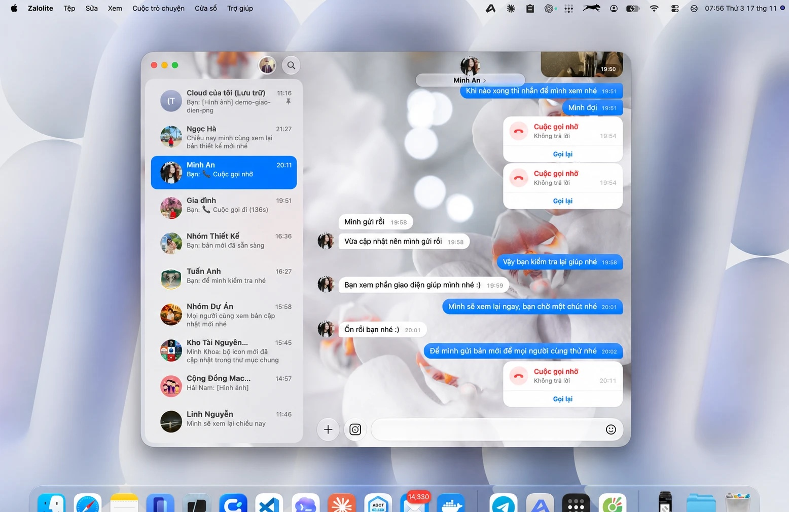
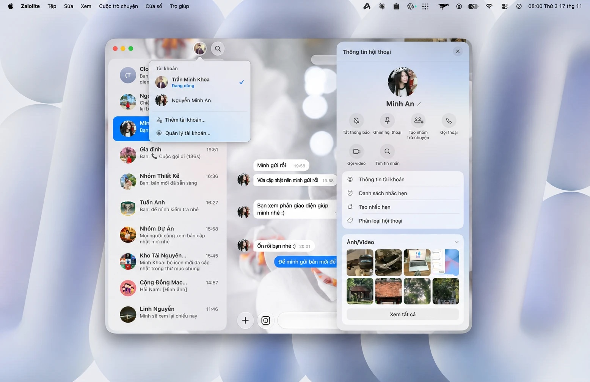
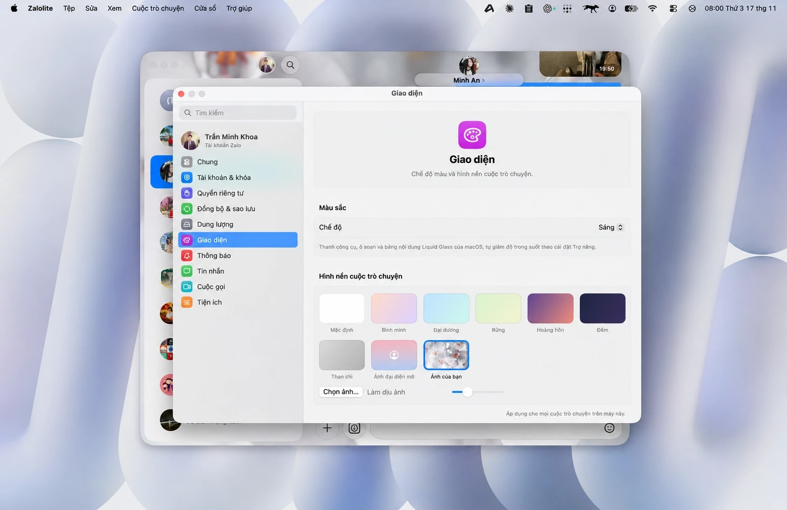

<div align="center">


# Zalolite

**Ứng dụng Zalo native cho macOS — nhẹ, nhanh, đúng chất Mac.**

Giao diện SwiftUI/AppKit với Liquid Glass, lõi Rust xử lý mạng và dữ liệu.<br>
Không Electron, không Chromium, không Node.js.

[](https://github.com/lebad280324/zalolite/releases/latest)
[](#cài-đặt)
[](#giấy-phép-và-ghi-nhận)
[](native/macos/CTDoNative)
[](src)

[**⬇ Tải về**](https://github.com/lebad280324/zalolite/releases/latest) ·
[Tính năng](#tính-năng) ·
[Cài đặt](#cài-đặt) ·
[Build từ mã nguồn](#build-từ-mã-nguồn) ·
[Báo lỗi](https://github.com/lebad280324/zalolite/issues)

<br>



<sub>Ảnh chụp trên macOS 26 với Liquid Glass và hình nền cuộc trò chuyện tự chọn.</sub>

</div>

---

## Vì sao là Zalolite?

| | |
| :--- | :--- |
| 🪶 **Nhẹ** | Bộ cài khoảng 27 MB, chạy cả Apple Silicon lẫn Intel. Giao diện native của macOS và một worker Rust, không kèm trình duyệt nhúng. |
| ⚡ **Mượt** | Tin nhắn vẽ bằng AppKit/CoreText, lịch sử phân trang, cache ảnh; cuộn và đổi kích thước cửa sổ nhẹ nhàng. |
| 🍎 **Đúng chất Mac** | Liquid Glass trên macOS 26, chế độ sáng/tối, thông báo hệ thống, huy hiệu Dock, thanh menu. |
| 🔒 **Riêng tư** | Session, khóa và lịch sử chỉ nằm trên máy bạn. Không máy chủ trung gian, không thu thập dữ liệu. |
| 🗂️ **Mang lịch sử theo** | Nhập bản sao lưu Zalo PC (`.zl.zip`), đồng bộ tin nhắn từ điện thoại. |

## Điểm nổi bật so với Zalo PC

So sánh với Zalo PC 26.11.10 cho macOS, đo trên cùng một máy Apple Silicon.

| | Zalolite | Zalo PC |
| :--- | :--- | :--- |
| Công nghệ | SwiftUI/AppKit native + lõi Rust | Electron (Chromium + Node.js) |
| Dung lượng sau cài đặt | **≈ 67 MB** (bộ cài ≈ 27 MB) | ≈ 766 MB |
| Giao diện | Liquid Glass của macOS 26, theo chế độ sáng/tối của hệ thống | Giao diện web dùng chung cho Windows và macOS |
| Mở hội thoại ẩn | **Touch ID** hoặc mật khẩu máy | Mã PIN riêng |

**Trải nghiệm riêng của Zalolite**

- 🎨 **Hình nền cho cuộc trò chuyện** — bảng màu có sẵn, ảnh đại diện làm mờ hoặc ảnh của bạn, kèm thanh làm dịu ảnh để chữ luôn dễ đọc.
- 👥 **Nhiều tài khoản trong một cửa sổ** — chuyển tài khoản ngay từ nút ảnh đại diện trên thanh công cụ, dữ liệu tách riêng từng tài khoản.
- 🔎 **Tìm trong hội thoại rõ ràng** — đếm `n/N`, nhảy qua lại bằng Enter / ⇧Enter, tô vàng từ khóa ngay trong bong bóng.
- 📞 **Thẻ cuộc gọi gọn** — loại cuộc gọi, thời lượng hoặc lý do (không trả lời, từ chối) và nút Gọi lại trong cùng một thẻ.
- 🗄️ **Lịch sử thuộc về bạn** — lưu SQLite trên máy, nhập được bản sao lưu `.zl.zip` của Zalo PC, xuất dữ liệu khi cần.

<sub>Zalolite chưa thay thế đầy đủ Zalo PC; xem <a href="docs/BA_FEATURE_COVERAGE.md">phạm vi chức năng</a>.</sub>

## Ảnh giao diện

<table>
  <tr>
    <td width="50%"><br><sub><b>Thông tin hội thoại &amp; nhiều tài khoản</b> — tác vụ nhanh, nhắc hẹn, ảnh/video; chuyển tài khoản từ thanh công cụ</sub></td>
    <td width="50%"><br><sub><b>Giao diện</b> — chế độ sáng/tối, hình nền có sẵn hoặc ảnh của bạn</sub></td>
  </tr>
</table>

## Tính năng

### 💬 Nhắn tin
- Gửi, nhận tin nhắn 1-1 và nhóm theo thời gian thực qua WebSocket.
- Trả lời trích dẫn, chuyển tiếp, thả cảm xúc, thu hồi, xóa phía tôi, chọn nhiều tin.
- Ảnh, video, tệp: kéo thả, dán từ clipboard, xem ảnh ở độ phân giải gốc.
- Nhãn dán động, emoji, gợi ý nhãn dán khi gõ; mẫu tin nhanh với `/`, gợi ý thành viên với `@`.
- Hiển thị trạng thái **đang soạn tin** của người bên kia.
- Thẻ cuộc gọi (thời lượng, gọi nhỡ, gọi lại), danh thiếp Zalo, xem trước liên kết, thông báo nhóm và tin từ tài khoản OA.

### 🗂️ Hội thoại và danh bạ
- Ghim, tắt thông báo, đánh dấu chưa đọc, phân loại hội thoại; ẩn hội thoại, mở lại bằng Touch ID hoặc mật khẩu máy.
- Tìm hội thoại, tin nhắn, tệp; tìm trong hội thoại có đếm số kết quả, nhảy qua lại bằng Enter và tô sáng từ khóa.
- Danh bạ theo chữ cái, lời mời kết bạn, tìm theo số điện thoại, chặn/bỏ chặn, tạo nhóm, thêm thành viên.
- Trang hồ sơ với ảnh đại diện và ảnh bìa gốc, tên gợi nhớ.

### 🔔 Tích hợp macOS
- Thông báo tin nhắn và cuộc gọi đến, nhấn vào mở đúng hội thoại; số chưa đọc trên Dock.
- Chạy nền với biểu tượng trên thanh menu, mở cùng máy.
- Chế độ sáng/tối, ảnh nền hội thoại, Liquid Glass (macOS 26+), tôn trọng tùy chọn Giảm chuyển động.

### 🧳 Dữ liệu và tài khoản
- Đăng nhập bằng mã QR; nhiều tài khoản, dữ liệu tách riêng từng tài khoản.
- Lịch sử lưu trong SQLite trên máy, tải thêm khi cuộn lên.
- Nhập bản sao lưu Zalo PC (`.zl.zip`) kèm ảnh/tệp; đồng bộ tin nhắn từ điện thoại có tiến độ và nút hủy.
- Xuất dữ liệu, xem dung lượng, dọn cache.

> [!NOTE]
> Các chức năng có kiểm thử tự động bằng dữ liệu mẫu, nhưng chưa phải luồng nào cũng đã thử với tài khoản Zalo thật
> (ví dụ cuộc gọi video). Xem [phạm vi chức năng](docs/BA_FEATURE_COVERAGE.md) và [ghi chú phát hành](docs/releases/v0.0.12.md)
> để biết giới hạn hiện tại.

### 🤖 Trợ lý AI
- Cho Codex, Claude Code hoặc Claude Desktop trên máy **đọc những hội thoại bạn chọn** rồi hỏi, ví dụ "liệt kê việc tôi đã nhận mà chưa xong trong nhóm Kinh doanh 3 ngày qua".
- Tắt theo mặc định, chỉ đọc, không gửi được tin nhắn; tắt là dừng ngay. Xem [hướng dẫn cài đặt Trợ lý AI](docs/TRO_LY_AI.md).

## Cài đặt

**Yêu cầu:** macOS 14 Sonoma trở lên, trên Mac Apple Silicon (M1 trở lên) hoặc Mac Intel. Một gói Universal chạy
trên cả hai loại chip, không cần chọn bản. Hiệu ứng Liquid Glass cần macOS 26 trở lên.

1. Tải `Zalolite-<phiên-bản>-macos-universal.dmg` ở trang [Releases](https://github.com/lebad280324/zalolite/releases/latest).
2. Mở DMG, kéo **Zalolite.app** vào **Applications**. Nếu đang có bản cũ, thoát nó trước khi thay.
3. Mở Zalolite và quét mã QR bằng ứng dụng Zalo trên điện thoại.

<details>
<summary><b>macOS báo không mở được vì chưa xác minh nhà phát triển?</b></summary>

<br>

Ứng dụng hiện được ký ad-hoc, chưa được Apple notarize. Trước hết, đối chiếu checksum với `SHA256SUMS.txt` của bản phát hành:

```sh
shasum -a 256 ~/Downloads/Zalolite-*-macos-universal.dmg
```

Sau đó vào **System Settings → Privacy & Security**, kéo xuống và chọn **Open Anyway**. Chỉ cần làm một lần.
</details>

### Dùng thử không cần tài khoản

Chế độ dữ liệu mẫu không đọc session và không kết nối Zalo, phù hợp để xem giao diện:

```sh
open -n /Applications/Zalolite.app --args --demo
```

## Quyền riêng tư và bảo mật

- Zalolite kết nối **trực tiếp** tới máy chủ Zalo, không qua máy chủ trung gian nào.
- Session, cookie, khóa mã hóa và lịch sử chat chỉ lưu trong `~/Library/Application Support/ctdozlite-native/`, tách theo tài khoản.
- Giao diện và worker nói chuyện qua pipe stdin/stdout, **không mở cổng mạng** cục bộ; khóa phiên không đi qua cầu nối này.
- Gói phát hành không chứa tài khoản hay dữ liệu chat. Đăng xuất chỉ xóa phiên đăng nhập, lịch sử vẫn giữ lại.

Chi tiết trong [SESSION_SECURITY.md](SESSION_SECURITY.md). Nếu phát hiện lỗ hổng, vui lòng báo riêng qua
[GitHub Security Advisories](https://github.com/lebad280324/zalolite/security/advisories/new) thay vì mở issue công khai.

## Kiến trúc

```text
┌───────────────────────────────┐   JSON Lines   ┌───────────────────────────────┐
│ Zalolite.app (SwiftUI/AppKit) │ ◀────────────▶ │ ctdozlite-core (Rust, Tokio)  │
│ • Danh sách, khung trò chuyện │  stdin/stdout  │ • Session, ký và mã hóa       │
│ • Bộ vẽ tin nhắn CoreText     │                │ • HTTP + WebSocket của Zalo   │
│ • Thông báo, Dock, thanh menu │                │ • SQLite, media, sao lưu      │
└───────────────────────────────┘                └───────────────────────────────┘
```

Giao diện chỉ hiển thị và gửi lệnh; mọi tác vụ mạng, mã hóa và đọc ghi ổ đĩa chạy trong worker Rust, không làm khựng giao diện.
Xem [docs/MACOS_NATIVE.md](docs/MACOS_NATIVE.md) và các ADR
[0004](docs/adr/0004-native-macos-frontend.md), [0006](docs/adr/0006-native-transcript-and-history-pages.md),
[0007](docs/adr/0007-coretext-message-rows.md).

| Thư mục | Nội dung |
| :--- | :--- |
| [`native/macos/CTDoNative`](native/macos/CTDoNative) | Ứng dụng SwiftUI/AppKit và cầu nối `NativeBridge` |
| [`src/native_core`](src/native_core) | Worker Rust phục vụ giao diện native |
| [`src`](src) | Giao thức Zalo, session, mã hóa, SQLite, media, cuộc gọi |
| [`packaging`](packaging) | Script đóng gói `.app`, DMG, ZIP |
| [`docs`](docs) · [`re-notes`](re-notes) | Tài liệu, ADR và ghi chú giao thức |

## Build từ mã nguồn

Cần [Rust](https://rustup.rs) 1.75+, Xcode Command Line Tools và SDK macOS có SwiftUI/AppKit.

```sh
git clone https://github.com/lebad280324/zalolite.git
cd zalolite

# Kiểm thử
CMAKE_POLICY_VERSION_MINIMUM=3.5 cargo test --locked
swift test --build-system native --package-path native/macos/CTDoNative \
  --scratch-path target/swift-native --configuration release --disable-sandbox

# Đóng gói ra dist/Zalolite.app
CTDOZLITE_SWIFT_BUILD_SYSTEM=native bash packaging/package-native-macos.sh
open dist/Zalolite.app
```

`CMAKE_POLICY_VERSION_MINIMUM=3.5` cần khi dùng CMake 4.x. Gặp lỗi khác, xem [Xử lý sự cố](docs/KHAC_PHUC_SU_CO.md).

Một số crate, binary và bundle vẫn mang tên `ctdozlite` để giữ tương thích. Mã egui/TUI cũ được giữ để truy vết;
sản phẩm phát hành của repo này là **Zalolite native macOS**.

## Đóng góp

- **Báo lỗi, đề xuất:** mở [issue](https://github.com/lebad280324/zalolite/issues/new/choose), ghi phiên bản macOS, phiên bản Zalolite và các bước tái hiện. Che thông tin cá nhân trong ảnh chụp.
- **Gửi mã:** đọc [AGENTS.md](AGENTS.md) và [chuẩn kỹ thuật](docs/standards) trước khi mở pull request. Thay đổi giao thức cần bằng chứng trong `re-notes/` và kiểm thử.
- **Không bao giờ commit** `session.json`, `*.db`, cookie hay bản ghi gói tin.

## Giấy phép và ghi nhận

Mã nguồn phát hành theo **MIT OR Apache-2.0** — xem [LICENSE-MIT](LICENSE-MIT) và [LICENSE-APACHE](LICENSE-APACHE).
Một số thành phần bắt nguồn từ [ctdozlite](https://github.com/ctdoteam1110/ctdozlite); bản quyền và lịch sử đóng góp được giữ nguyên.
Phần đóng góp Zalolite được ghi nhận cho [lebad280324](https://github.com/lebad280324). Chi tiết trong
[THIRD_PARTY_NOTICES.md](THIRD_PARTY_NOTICES.md) và [NOTICE](NOTICE).

> [!IMPORTANT]
> Zalolite là dự án độc lập, **không phải** ứng dụng chính thức và không liên kết với Zalo hay VNG.
> “Zalo” là nhãn hiệu của chủ sở hữu tương ứng. Hãy sử dụng phù hợp với điều khoản dịch vụ của Zalo.
